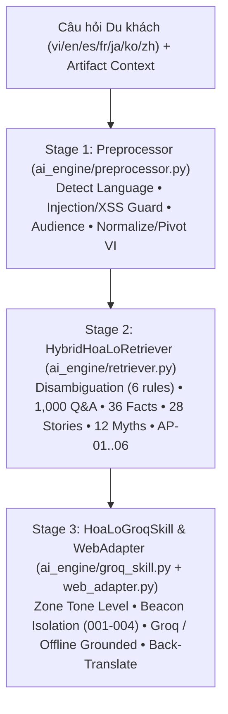

# 🧠 AI ENGINE ARCHITECTURE — HOA LO GROQ SKILL (VIETNAMESE-PIVOT HYBRID RAG)

Tài liệu mô tả động cơ trí tuệ nhân tạo độc lập của dự án nằm tại `ai_engine/` (đồng bộ từ gói `hoa_lo_groq_skill/`), sử dụng hoàn toàn bộ tri thức mới `dataset_hoa_lo_vi` kết hợp hệ thống chỉ mục đa ngôn ngữ. Toàn bộ engine AI cũ (`kiemthu/`, `dataset_finetune/`, Auto-Learning cũ) đã được loại bỏ khỏi dự án.

---

## 1. Quy trình Trục Tiếng Việt 3 Giai đoạn (`Vietnamese-Pivot Pipeline`)

### Stage 1: Tiền xử lý & Chuẩn hóa (`preprocessor.py` + `prompts/preprocess_vi_prompt.md`)
- **Nhận diện 7 ngôn ngữ đầu vào**: `vi`, `en`, `es`, `fr`, `ja`, `ko`, `zh` (`detect_language`).
- **Bảo vệ đầu vào**: `sanitize_and_guard_input()` chặn XSS, SQLi và cố gắng ghi đè system prompt.
- **Chuẩn hóa tiếng Việt & Từ khóa Di sản**: `normalize_vietnamese_text()` chuẩn hóa viết tắt (*nt hoa lo* → *Nhà tù Hỏa Lò*, *pbc* → *Phan Bội Châu*, *ca sot* → *ngục tối Cachot*...), xử lý không dấu và từ đồng nghĩa đa ngôn ngữ (`HOA_LO_GLOSSARY`).
- **Phân loại Ý định & Đối tượng**: `classify_intent()` (`yes_no`, `open_fact`, `out_of_scope`...) và `detect_audience()` (`child` / `general`).

### Stage 2: Đối soát Dữ liệu Gốc Tiếng Việt (`retriever.py`)
`HybridHoaLoRetriever` nạp trực tiếp các tập tri thức đã tổng hợp từ `dataset_hoa_lo_vi`:
- `zones_catalog.json`: **14 phân khu** (`Z01`–`Z14`) kèm danh sách hiện vật và mốc `audit_baseline`.
- `kb_golden_qa.json`: **1.000 cặp Hỏi–Đáp chuẩn lịch sử tiếng Việt (`HL-001`..`HL-1000`)**.
- `hoa_lo_vi_enrichments.json`:
  - **36 Atomic Fact Cards** (dữ kiện hạt nhân kèm mốc thời gian/kích thước chuẩn từng khu).
  - **28 Micro-Stories (`MS-01`..`MS-28`)** và **12 Myth-Busters (`MB-01`..`MB-12`)** giải mã hiểu lầm phổ biến (như đêm Noel 1951, máy chém, cây bàng...).
  - **6 Quy tắc Phân định Thực thể (`disambiguation_rules`)** giúp tránh nhầm giữa *Hỏa Lò* (từ khóa chung) vs *1951 cống ngầm*, *1945 vượt ngục*, *Côn Đảo*, *Yên Bái*, *Tượng đài*, v.v.
  - **`tone_level` theo phân khu**: Ví dụ **Cấp 1 — Trang nghiêm tuyệt đối (Wit = 0%)** cho các khu tưởng niệm/Cachot/Máy chém (`Z03`, `Z05`, `Z12`...) và **Cấp 2 — Sắc sảo & Khâm phục (Độ dí dỏm 20–30%)** cho các khu phù hợp (`Z01`, `Z02`, `Z07`, `Z08`...).
- `kb_extended_questions.json`: **1.600 câu hỏi mở rộng** (`500` Bộ 1 + `500` Bộ 2 + `600` 4 Ngôn ngữ EN/ES/ZH/JA) nối chéo ID về Golden Q&A.
- `kb_audit_dataset.json` & `audit_anti_patterns.md`: **500 dòng kiểm định AI 2Guide**, **13 ca lỗi Groq**, **11 ca Guardrail từ chối nhầm**, **5 khuyến nghị** và **6 luật Anti-Pattern (`AP-01..AP-06`)**.

### Stage 3: Tổng hợp Câu trả lời & Giao tiếp Web (`groq_skill.py`, `web_adapter.py`, `web_server.py`)
- **Failover Groq Pool**: Khi cấu hình `GROQ_API_KEY`, hỗ trợ luân chuyển model trong nhóm reasoning (`llama-3.3-70b-versatile`, `qwen/qwen3-32b`, `openai/gpt-oss-120b`, `openai/gpt-oss-20b`) và nhóm light (`llama-3.1-8b-instant`, `openai/gpt-oss-20b`, `llama-3.3-70b-versatile`); tự động lọc bỏ block `<think>...</think>`.
- **Chế độ Offline Deterministic**: Khi không có `GROQ_API_KEY` (hoặc quota 429/mất mạng), tự động tổng hợp trực tiếp từ cặp Q&A, Fact Cards và Myth-Busters đã đối soát (và dịch qua `/api/translate` hoặc bảng từ khóa đa ngôn ngữ khi cần).
- **Cô lập Beacon Hiện vật (`001`–`004`)**: Ngăn rò rỉ tri thức Hỏa Lò khi khách đang đứng trước hiện vật độc lập ngoài Hỏa Lò như **Mã 001 (Trống Đồng Đông Sơn)**, **Mã 003 (Đạt Hồng — Đại Hồng Chung)**, **Mã 004 (Bảo Kiếm Hoàng Gia Triều Nguyễn)**, trong khi giữ đúng ngữ cảnh **Mã 002 (Cây Bàng Lịch Sử Hỏa Lò)**.
- **Kiểm định Đầu ra Plain-Text (`prompts/web_style_rules.md`)**: Tối ưu câu văn xuôi tự nhiên, loại bỏ ký tự Markdown gây khựng cho hệ thống đọc TTS `.WAV`.
