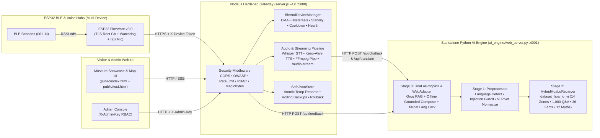

# 🏛️ SYSTEM ARCHITECTURE — HỎA LÒ SMART MUSEUM GATEWAY V4.0

Tài liệu đặc tả kiến trúc hệ thống **Hỏa Lò Smart Museum Guide V4.0** sau khi thay thế toàn bộ AI cũ (`kiemthu/`, Auto-Learning cũ) bằng **Standalone Python AI Engine (`ai_engine/`)** theo quy trình **Vietnamese-Pivot 3-Stage Hybrid RAG** sử dụng bộ dữ liệu mới `dataset_hoa_lo_vi`.

---

## 1. Kiến trúc Dual-Service (V4.0)

| Thành phần | Công nghệ & Cổng | Trách nhiệm chính |
| :--- | :--- | :--- |
| **Node.js Web & IoT Gateway** (`server.js`) | Node.js HTTP/SSE (`PORT=5000`), không phụ thuộc framework nặng | Phục vụ Web UI tĩnh, bảo mật OWASP/CORS/RBAC/RateLimit, quản lý đa thiết bị BLE ESP32, tổng hợp âm thanh **Single Progressive Streaming `.WAV`** qua FFmpeg pipe, và quản trị vòng đời tiến trình con `ai_engine/web_server.py`. |
| **Python AI Engine** (`ai_engine/web_server.py`) | Python HTTP JSON (`AI_PORT=4001`, chế độ test `4011`) | Thực thi pipeline **Vietnamese-Pivot 3-Stage Hybrid RAG**, tiền xử lý chuẩn hóa/dịch trục Tiếng Việt, đối soát 1.000 Q&A + 36 Fact Cards + 28 Micro-Stories + 12 Myth-Busters + 6 luật phân định danh từ, cô lập ngữ cảnh Beacon `001`–`004`, và ghi log phản hồi append-only. |

---

## 2. Sơ đồ Kiến trúc Tổng thể

---

## 3. Danh mục Module Cốt lõi

| Đường dẫn | Trách nhiệm |
| :--- | :--- |
| `server.js` | HTTP/SSE Gateway V4.0, tiến trình quản lý `ensureAiEngineReady()` / `stopAiEngine()`, `queryHoaLoAI()`, `translateTextStrict()`, pipeline TTS Streaming `.WAV`, định tuyến API công khai/IoT/Admin. |
| `src/security/security_middleware.js` | CORS allowlist, OWASP headers, `RateLimiter` 4 tầng theo IP, `verifyAdminRequest` fail-closed, `DeviceAuthManager` SHA-256 token RBAC, `validateAudioBufferMagic`, `validateBeaconPayload`, `safeErrorResponse`. |
| `src/storage/safe_store.js` | `SafeJsonStore` ghi atomic (`temp → rename`), rolling backup tại `data/backups/`, tự khôi phục JSON lỗi, rollback 1 bước, `sanitizeForLog` ẩn secret. |
| `src/iot/ble_manager.js` | `BleAndDeviceManager`: làm mượt RSSI bằng EMA ($\alpha = 0.35$), hysteresis `+6 dBm`, stability counter `>= 2`, smart cooldown từng `(device_id, beacon_id)`, phát hiện trùng MAC/code, calibration, heartbeat & health telemetry (`ONLINE` / `DEGRADED` / `OFFLINE`). |
| `ai_engine/preprocessor.py` | Chuẩn hóa Unicode, tách/sửa viết tắt/teencode tiếng Việt, bắc cầu thuật ngữ 7 ngôn ngữ (`vi/en/es/fr/ja/ko/zh`) sang tiếng Việt, nhận diện intent, audience (`child`/`general`), chống Prompt Injection/XSS/SQLi. |
| `ai_engine/retriever.py` | Truy xuất `HybridHoaLoRetriever` trên `dataset_hoa_lo_vi`: 14 phân khu (`Z01`–`Z14`), 1.000 Q&A (`HL-001`..`HL-1000`), 36 Atomic Fact Cards, 28 Micro-Stories, 12 Myth-Busters, 6 quy tắc phân định thực thể, 500 bản ghi Audit 2Guide và cảnh báo `AP-01..AP-06`. |
| `ai_engine/groq_skill.py` | `HoaLoGroqSkill` lắp ráp system/user prompt chuẩn Trục Tiếng Việt, nhúng `tone_level` theo phân khu, gọi Groq API hoặc chạy chế độ offline deterministic, làm sạch thẻ `<think>`. |
| `ai_engine/web_adapter.py` | `HoaLoWebAdapter`: cách ly `sessionId` theo từng thiết bị ESP32/Web, LRU cache, cô lập hiện vật Beacon `001`–`004` (tránh trộn Trống Đồng Đông Sơn với Cây Bàng Hỏa Lò), chế độ plain-text cho TTS, ghi log `/api/feedback` vào JSONL append-only. |
| `ai_engine/web_server.py` | HTTP microservice độc lập cổng `4001` phục vụ `/health`, `/stats`, `/api/chat/ask`, `/api/hub/ask`, `/api/voice-query`, `/api/translate`, `/api/feedback`. |
| `esp32_firmware/esp32_ble_dialogue.ino` | Firmware ESP32 với TLS Root CA (`ISRG_ROOT_X1_CA`), Hardware Watchdog 15s, Wi-Fi exponential backoff, thu âm I2S INMP441, barge-in và gửi heartbeat định kỳ. |

---

## 4. Luồng Xử lý Chính (Request Flows)

### 4.1 Luồng BLE Beacon Trigger
1. ESP32 hoặc Web Simulator gửi `POST /api/ble-scan` với `device_id`, `beacon_mac` (hoặc `code`), `rssi`, tùy chọn `language`.
2. Gateway kiểm tra Rate Limit (`ble` tier) & `DeviceAuthManager.verifyDevice()`, sau đó `BleAndDeviceManager.evaluateBleScan()` tính EMA RSSI, hysteresis `+6 dBm`, số hit ổn định và cooldown.
3. Nếu `TRIGGER` và ngôn ngữ thiết bị khác `vi`, Gateway gọi `translateTextStrict()` chuyển tiếp sang AI Engine `/api/translate`, tổng hợp cache file `.wav` đa ngôn ngữ nếu cần và phát SSE `BEACON_TRIGGERED`.

### 4.2 Luồng Hỏi Đáp Giọng Nói & Văn Bản (`POST /api/hub/ask`)
1. Client gửi JSON text hoặc file audio thô (`.wav`/`.mp3`/`.ogg`/`.flac`/`.m4a`/`.webm`, tối đa `5 MB`, kiểm tra magic bytes thực tế — sai trả `415`).
2. Nếu là audio, Gateway gọi STT (Whisper qua Groq nếu cấu hình `GROQ_API_KEY`, kèm RMS Silence Guard).
3. Gateway gọi `queryHoaLoAI()` (`POST http://127.0.0.1:4001/api/chat/ask`) truyền câu hỏi, `artifactContext`, `sessionId` riêng của thiết bị và ngôn ngữ đang khóa.
4. Python AI Engine chạy quy trình 3 giai đoạn Trục Tiếng Việt trên `dataset_hoa_lo_vi`, trả về `reply` sạch Markdown + metadata (`intent`, `zoneId`, `retrievedIds`, `provider`).
5. Gateway chia đoạn câu ngắn (`<= 148` ký tự), tổng hợp PCM trong RAM qua Google TTS + FFmpeg pipe và phát qua `/audio-stream/reply_<ts>.wav` (`RIFF/WAVE` chunked stream nối liền các đoạn sau ngay khi đang phát đoạn 1).
